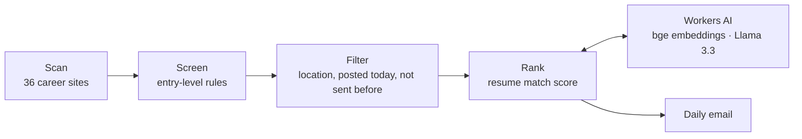

# Job Search Agent

A daily job-hunting agent. Every evening it scans the career sites of about 40 tech companies, keeps the newly posted entry-level software roles, ranks them against my resume with Workers AI (embeddings + Llama 3.3), and emails me the best matches. It runs free on GitHub Actions.

**Stack:** TypeScript · Node · Cloudflare Workers AI · GitHub Actions · 114 tests

## On-time emails

GitHub often starts scheduled runs hours late. To get the email at 7 pm Chicago time, a small Cloudflare Worker (free plan) starts the workflow on time; the GitHub crons remain as a fallback.

1. Create a [fine-grained GitHub token](https://github.com/settings/personal-access-tokens/new): repository access *Only select repositories* → this repo, permission *Actions: Read and write*.
2. `npx wrangler login`
3. `npx wrangler secret put GITHUB_TOKEN -c wrangler.trigger.jsonc` and paste the token.
4. `npm run deploy:trigger`

To check it, open the Worker's *Settings → Trigger Events* in the Cloudflare dashboard, or run the workflow by hand with mode `scheduled`.
