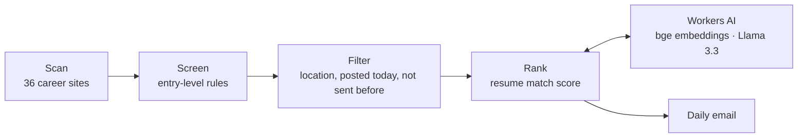

# Job Search Agent

A daily job-hunting agent. Every evening it scans the career sites of about 40 tech companies, keeps the newly posted entry-level software roles, ranks them against my resume with Workers AI (embeddings + Llama 3.3), and emails me the best matches. It runs free on GitHub Actions.

**Stack:** TypeScript · Node · Cloudflare Workers AI · GitHub Actions · 102 tests
