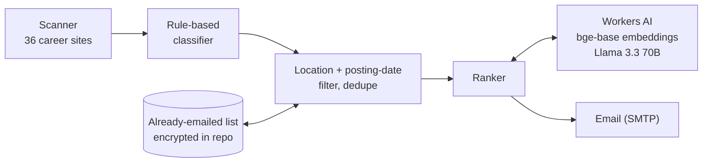

# Job Tracker Agent

**A daily job-hunting agent.** Every evening it scans the career sites of about 40 tech companies, keeps the entry-level software roles posted since the last run, ranks them against your resume with Workers AI (embeddings + Llama 3.3), and emails you a short list with the best matches on top. It runs free on GitHub Actions.

   

## What a run does

1. **Scan.** Reads 36 career sites directly: the public Greenhouse, Lever and Ashby APIs, Workday's JSON API, and the APIs behind Amazon, Microsoft, Netflix, Apple and Bloomberg's careers pages. Requests are paced per site, capped per company, and back off on HTTP 429.
2. **Screen.** A rule-based classifier keeps software roles (SWE, SDE, Backend, Frontend, Full-stack, QA/SDET) and labels each one *Entry* or *Maybe*, using the title and the years of experience the description asks for. Senior, staff, intern and clearance-required roles are dropped. No model calls are needed for this step.
3. **Filter.** Keeps jobs in your locations that were posted today or yesterday and haven't been emailed before. When a site gives no posting date, a job counts as new the first day it appears.
4. **Rank.** Embeds your resume and each job description with `bge-base-en-v1.5`, and scores each job by cosine similarity (0-100). For the top picks, Llama 3.3 writes one line on why the job fits and the biggest gap.
5. **Email.** Sends an HTML email with the top picks first (score, why, gap), then the rest by score. Each job shows its company, title, location, posting date and link.



## Engineering notes

- **Tested without the network.** 102 `node:test` tests use fake fetch, LLM and embedding functions. They cover every source's parser, the screening rules, location and date filters, ranking, email rendering and the schedule.
- **Defensive parsing.** Posting dates arrive as epoch seconds or milliseconds, ISO strings, "Oct 10, 2026" or Workday's "Posted 3 Days Ago". They are normalized in one place, and a bad value can't break a run. A site that fails is listed at the bottom of the email, and the others still go out.
- **Graceful degradation.** If ranking fails (quota, network, missing resume), the email is still sent, grouped by level, with a note saying why.
- **Platform-neutral core.** `src/core` has no Node or Cloudflare imports. I/O comes in through small interfaces, so the same scanner and screening code also powers an optional Cloudflare web app (below).
- **No secrets in the repository.** Credentials and the resume live in GitHub Actions secrets or a local `.env`. The list of jobs already emailed is committed encrypted (AES-256, key in secrets), so the repository can be public.
- **Respectful scraping.** Each source was checked against the live site and its `robots.txt`. Google, Meta, LinkedIn and Uber are not scraped.

## Run it on GitHub Actions (free)

`.github/workflows/alerts.yml` runs every day at 7 pm Chicago time. It handles daylight saving and runs once a day.

1. Fork or push this repository.
2. Settings → Secrets and variables → Actions → **Secrets**:
   | Secret | Value |
   |---|---|
   | `SMTP_USER`, `SMTP_PASS` | Gmail address and an [App Password](https://myaccount.google.com/apppasswords) |
   | `CF_ACCOUNT_ID`, `CF_API_TOKEN` | Cloudflare account ID and an API token from the "Workers AI" template |
   | `RESUME_TEXT` | Your resume as plain text |
   | `STATE_KEY` | Any long random string, e.g. from `openssl rand -hex 32` |
   | `MAIL_TO` | Optional. Defaults to `SMTP_USER` |
3. **Variables** (optional): `ALERT_LOCATIONS` (e.g. `United States, USA, US`), `ALERT_MAX_AGE_DAYS`, `ALERT_TOP_N`.
4. Actions → **Job alerts** → Run workflow → `test-email`, then `send`.

Run logs in a public repository are public, and the `dry-run` mode prints the whole email there, so in a public repository use `test-email` and `send`.

## Run it locally

```bash
npm install
cp .env.example .env               # SMTP_USER, SMTP_PASS, CF_ACCOUNT_ID, CF_API_TOKEN
cp ~/path/to/resume.pdf resume.pdf # git-ignored
npm test
npm run alerts -- --test-email     # check email settings
npm run alerts -- --dry-run        # scan, rank and print the email without sending
npm run alerts                     # scan, rank and send
npm run alerts:install             # every day at 7 pm via macOS launchd (alerts:uninstall to stop)
```

| Setting | Default | Meaning |
|---|---|---|
| `ALERT_LOCATIONS` | (all) | Keep jobs whose location mentions one of these, as whole words. US keywords also match "City, ST". |
| `ALERT_MAX_AGE_DAYS` | `1` | Only jobs posted today or yesterday. `0` sends every open match. |
| `ALERT_TOP_N` | `8` | How many top matches get an LLM note. `0` gives scores only. |
| `ALERT_RANKING` | on | `off` skips ranking (no Workers AI calls). |
| `ALERT_HOUR` | `19` | Hour for the launchd schedule. |

Ranking uses Workers AI's REST API, so nothing has to be deployed to Cloudflare. A day's run uses a small part of the free daily allowance.

## Screening rules

Defined in [`src/core/discover/classify.ts`](src/core/discover/classify.ts):

- **Entry:** the title says new grad, early career, junior, or SWE I / SDE I, or the description asks for at most 2 years of experience.
- **Maybe:** SWE II / SDE II, Software Engineer 3/4, IC3, L3/L4, MTS, or the description asks for a range that reaches 3 years.
- **Excluded:** senior, staff, lead, principal, manager, director, intern, 3+ years required, or a clearance or citizenship requirement.

## Sources

| Source | Companies |
|---|---|
| Greenhouse API | Anthropic, xAI, Waymo, Databricks, Airbnb, Stripe, Pinterest, DoorDash, Instacart, Lyft, Robinhood, Coinbase, Datadog, Reddit, Discord, Duolingo, Roblox, Figma, Cloudflare |
| Ashby API | OpenAI, Cohere, Mistral, Perplexity, Ramp, Snowflake |
| Lever API | Palantir, Spotify |
| Workday JSON API | Nvidia, Adobe, Salesforce, Snap |
| Careers-site APIs | Amazon, Microsoft, Netflix, Apple, Bloomberg |

Run `npm run check-companies` to check that every source still parses.

## Also included: a Cloudflare web app (optional)

The same core can run as an interactive app on Cloudflare. It is not needed for the daily emails.

- A chat assistant on Llama 3.3 with 10 tools: list jobs, add a job, update a status, revise a cover letter, and more.
- State in an Agents SDK Agent (Durable Object + SQLite).
- A daily Workflow that drafts follow-up emails for applications that have sat in "applied" for 14 days or more.
- Cloudflare Access login.

To try it, run `npm run local` (http://localhost:8787), or deploy it with `npx wrangler deploy`. If you deploy, turn on Cloudflare Access for it.

## Project layout

```
src/core/discover/   job sources, HTTP pacing, screening rules, posting dates
src/core/            alerts (filter, dedupe, email), ranking, and the optional web app's logic
src/node/            alerts CLI, mailer, launchd schedule, Workers AI REST client, local server
src/cloudflare/      optional web app on Workers (Agent, Workflow, Access check)
.github/workflows/   daily alerts on GitHub Actions
test/                102 tests, no network or credentials needed
```

## Known limits

- The match score ranks jobs against each other. It is not a probability of getting an interview.
- Big career sites are read through their search, capped at a few pages per query, so a few postings can be missed on busy days.
- Image-only (scanned) resume PDFs can't be read. Use `RESUME_TEXT` or a `.txt` file instead.
